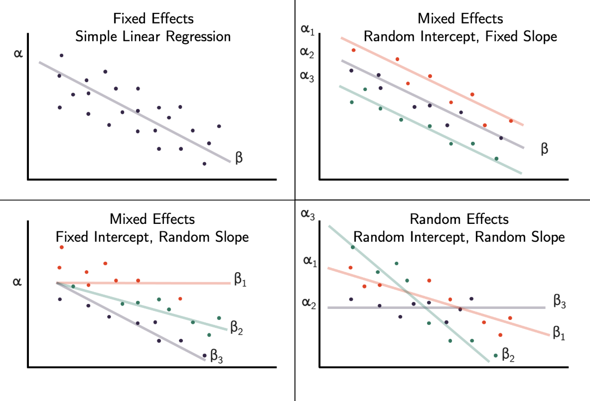
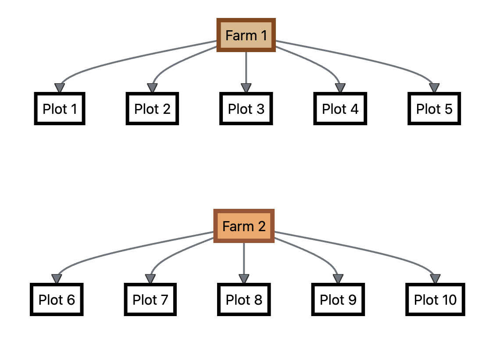

## Free statistical consulting for Yale researchers

\vspace{2.8em}

\begin{center}

\large
Study design $\cdot$ analysis $\cdot$ visualization $\cdot$ writing.

\vspace{1.4em}

\normalsize
Walk-ins, appointments, and workshops --- free for all Yale affiliates.

\vspace{2.8em}

\textcolor{statsecondary}{%
  \large\textbf{library.yale.edu/statlab}%
}


\end{center}


## Setup check

```{r,echo=FALSE}
options(width = 60)
source(here::here("./assets/scripts/data_gen.R"))
source(here::here("./assets/scripts/theme_better.R"))
```

```{r}
#| echo: true
library(lme4)
nrow(sleepstudy)

crop <- read.csv(here::here("./assets/data/crop_yield_data.csv"))
crop$farm_id <- factor(crop$farm_id)
str(crop)
```

If this doesn't work, please let us know!

## Identifying hierarchy: principles and examples 

* Standard statistical methods assume *independence of sampling*
* Failure to account for such hierarchy can lead to biased estimates, and both Type-I and Type-II errors
* Examples of hierarchy: \pause
    * students nested in classrooms (or in schools) 
    * patients seen by different doctors (and in different hospitals)
    * plants grown in different farms, etc. 

## Enter the *mixed-effects model* 

A \textcolor{blue}{linear mixed-effects model} (or just "mixed-effects model"), is an extension of a standard linear model, with the key addition of \textbf{random effects}

These random effects allow for: 

* accounting of within-group correlation 
* inference about group-specific \textit{and} population-level effects

\pause 
\vspace{5em}
\begin{center}
\textbf{We will focus mostly today on accounting for within-group correlation}
\end{center}

## Fixed vs. Random effects definitions 


Following [Gelman (2005)](https://arxiv.org/abs/math/0504499)^[This is an excellent piece worth a read for those interested. Gelman (2005) "Analysis of variance--why it is more important than ever" (*The Annals of Statistics*)]:

\Large

* **Fixed** effects are the effects or coefficients that are identical for all groups in a population
* **Random** effects are those which are allowed to differ from group to group

\vspace{1.5em}

\small Caution: econometric "fixed effects" (a dummy per group) is not what we're talking about!

## Random effects -- what kinds are there? 



## Fixed or random?!? Some rules of thumb

* **Do you care about these specific levels, or about the variation among them?**
  * New drug vs. placebo: we care about that exact comparison, so **fixed**.
  * These particular 20 classrooms: they stand in for all classrooms, so **random**.

. . .

* **Would a new study use the *same* levels?**
  * A repeat study would compare the same drug and placebo (fixed), but with different doctors, classrooms or patients (random).

. . .

* **How many levels are there?**
  * With fewer than about 5–6 groups, there isn't enough information to estimate a variance, so treat it as fixed.

. . .

* **Is it a continuous predictor you care about** (like a dose, or hours of study)?
    * Fixed, though its effect may *vary* by group (more on that soon!)

<!-- ## EXERCISE: Identify structure and fixed vs random effects

> \small A plant physiologist wants to know whether cold stress reduces how much $CO_2$ a grass can take up. She collects 12 plants of the same grass species: 6 from Quebec and 6 from Mississippi. Half the plants from each region are chilled overnight and the other half aren't. She then measures $CO_2$ uptake on every plant at 7 different $CO_2$ concentrations, from low to high, for 84 measurements in total.

\vspace{0.5em}

**With your neighbour please discuss:**

1. What's the grouping? How many groups, and how many observations in each?
2. For each variable (region, chilling, concentration, plant), would you treat it as fixed or random? Why?
3. Which predictors change *within* a plant, and which only *between* plants?
4. Could the effect of concentration differ from plant to plant? What about the effect of chilling?

## EXERCISE: some answers (1/2)

**1. What's the grouping?**

**Grouping is at the level of plant**: We said she has12 plants, each measured 7 times (84 observations). Importantly, region and chilling aren't groupings here; they're properties *of* each plant.

. . .

**2. Fixed or random?**

\small

* **Chilling**: fixed. It's the treatment we care about, and it has only 2 levels
* **Region**: fixed. Only 2 levels (you can't estimate a variance from 2 groups!), and we care about the comparison
* **Concentration**: fixed. A continuous predictor we want an effect for
* **Plant**: random. These 12 plants are a sample from all the plants we *could* have measured, and we want to generalize beyond them

. . .

*Could plant be fixed (a dummy per plant)?* Not if we want to estimate region or chilling: each plant has only one region and one treatment, so the plant dummies would soak up those effects completely!

\normalsize

## EXERCISE: some answers (2/2)

**3. Within or between?**

\small

* **Within** a plant: concentration (every plant sees all 7 levels)
* **Only between** plants: region and chilling

. . .

So for chilling and region we effectively have **12 plants, not 84 measurements** (3 per region $\times$ treatment combination). Ignoring the plant grouping would make us overconfident about those effects (false positives!), but only less precise about concentration.

\normalsize

. . .

**4. Could the effects differ from plant to plant?**

\small

* **Concentration**: plausibly yes, and we *can* estimate it, because it varies within each plant: a random slope, `(log(conc) | Plant)`. With only 12 plants, though, we might not have enough information (we'll come back to this!)
* **Chilling**: we can't estimate it! Each plant is either chilled or not, so there's no plant-specific chilling effect to estimate. (Chilling could still change the effect of concentration: a fixed `conc` $\times$ `Treatment` interaction.)

\normalsize -->

## Example data - effect of soil pH on crop yield

{width=30,fig-align="center"}

\begin{center}
\textbf{
We end up with a hierarchical data structure where observations within farms \textcolor{red}{cannot} be assumed independent
}
\end{center}

## Example data we'll use

```{r}
#| echo: true
crop <- read.csv(here::here("./assets/data/crop_yield_data.csv"))
crop$farm_id <- factor(crop$farm_id)
```

```{r}
#| label: fig-soil-data
#| fig-cap: "Simulated data for this example. Each farm is a different colour"
#| echo: false
#| fig-width: 4
#| fig-height: 3

library(ggplot2)

ggplot(data = crop) +
    geom_point(aes(x = soil_pH, y = crop_yield, colour = farm_id), show.legend = FALSE) +
    theme_bw() +
    labs(x = "Soil pH", y = "Crop Yield") +
    scale_colour_manual("Farm ID", values = MoMAColors::moma.colors("OKeeffe", n = nlevels(crop$farm_id), type = "continuous"))
``` 

## Formalism! 


Let's start with a nice simple model for our data^[$Y_{ij}$ - crop yield in plots $i$ nested within farm $j$. $x_{ij}$ - soil pH across same. ]:

\begin{equation}
Y_{ij} = \beta_0 + \beta_1 x_{ij} + \epsilon_{ij}
\end{equation}

. . .

We can now think about adding in a \textcolor{red}{random effect}`\footnote<2->{$\alpha_j$ is the \textcolor{red}{random effect} across $j = 1,\ldots,k$ farms.}`{=latex} by the following:


\begin{equation}
Y_{ij} = \beta_0 + \beta_1 x_{ij} + \alpha_j + \epsilon_{ij}
\end{equation}

. . . 

where`\footnote<3->{$\epsilon_{ij}$ is our random error}`{=latex}

\begin{equation}
\epsilon_{ij} \mathop\sim^{i.i.d.} N(0, \sigma^{2})\text{;    } \alpha_j \mathop\sim^{i.i.d.} N(0, \sigma^{2}_{\alpha})
\end{equation}

## Imagine all we knew was that our yields were taken from different farms

{width=40,fig-align="center"}

**How could we figure out how much variance was clustered within farms?**

## We can start with just our random effect

Say we didn't know anything about our predictor variables, so our model was: 

\begin{equation}
Y_{ij} = \beta_0 + \alpha_j + \epsilon_{ij}
\end{equation}

. . .

This means that with our simple model, we have the expected value being

\begin{equation}
\begin{aligned}
E[\alpha_{j}] &= \uncover<3->{0} \\
E[Y_{ij}] &= \uncover<3->{\beta_0}
\end{aligned}
\end{equation}

. . . 

\uncover<4->{
And the variance is then in turn 

\begin{equation}
\text{Var}(Y_{ij}) = \sigma_{\alpha}^2 + \sigma^2.
\end{equation}
}

## Correlation structure

And we get left with this very convenient correlation structure: 

\begin{equation}
\text{Cor}(Y_{ij},Y_{i'j'}) =
\begin{cases}
0 & j \neq j' \\
\sigma^2_{\alpha}/(\sigma^2_{\alpha} + \sigma^2) & j = j',\, i \neq i' \\
1 & j = j',\, i = i'
\end{cases}
\end{equation}

## Correlation structure

Or, if we return to our model including the fixed effect `\footnote<.->{This is the same structure, but $\sigma^2_\alpha$, $\sigma^2$ are now variances after accounting for $x$, and so won't take the same values as they would have on the previous slide.}`{=latex}
$$Y_{ij} = \beta_0 + \beta_1 x_{ij} + \alpha_j + \epsilon_{ij}$$

\begin{equation}
\text{Cor}(Y_{ij},Y_{i'j'} \mid \mathbf{X}) =
\begin{cases}
0 & j \neq j' \\
\sigma^2_{\alpha}/(\sigma^2_{\alpha} + \sigma^2) & j = j',\, i \neq i' \\
1 & j = j',\, i = i'
\end{cases}
\end{equation}

. . .

\begin{center}
\textbf{But why does this matter??}
\end{center}

. . .

\begin{center}
\textbf{\textcolor{red}{Because this is central to understanding the inference on this outcome of interest!}}
\end{center}

## This correlation quantity is known as the ICC (intraclass correlation)

\begin{equation}
ICC = \sigma^2_{\alpha}/(\sigma^2_{\alpha} + \sigma^2)
\end{equation}

\vspace{10mm} 

\begin{center}
This expression quantifies how much variation comes from \textit{between} farms. If the ICC is large, observations from the \textit{same} farm are much more similar than observations from \textit{different} farms.
\end{center}

## Let's fit a mixed-effects model! 

\begin{equation}
Y_{ij} = \beta_0 + \beta_1 x_{ij} + \alpha_j + \epsilon_{ij}
\end{equation}

```{r, echo=TRUE}
mod <- lme4::lmer(crop_yield ~ soil_pH + (1|farm_id), data = crop)
```

## Let's fit a mixed-effects model! {.fragile}

::: {.columns}

::: {.column}
```{r}
#| echo: true
#| eval: false
summary(mod)
```

```{r}
#| echo: false
#| results: asis
out <- capture.output(
    print(summary(mod), correlation = FALSE))
cat("\\begin{center}\\begin{minipage}{0.8\\linewidth}",
    "\\begin{Verbatim}[fontsize=\\scriptsize]", out, "\\end{Verbatim}",
    "\\end{minipage}\\end{center}", sep = "\n")
```
::: 

:::{.column width="30%"}

\vspace{3.5em}
What's going on here? We have:

1. Our model formula 
2. Intercept level variance 
3. Residual variance
4. Our point estimate (and variance) of our soil pH
::: 
:::

## How should we read this output?

```{r}
#| echo: false
vc_mod <- as.data.frame(VarCorr(mod))
```

We can map those back to our equation that we're fitting! 

\vspace{0.5em}

| `lme4` output | Math | Estimate Value |
|---|---|---|
| `farm_id (Intercept)` Variance | $\sigma^2_\alpha$ | `r round(vc_mod$vcov[1], 2)` |
| `Residual` Variance | $\sigma^2$ | `r round(vc_mod$vcov[2], 2)` |
| `(Intercept)` Estimate | $\beta_0$ | `r round(fixef(mod)[1], 2)` |
| `soil_pH` Estimate | $\beta_1$ | `r round(fixef(mod)[2], 2)` |

. . .

It's important to note here that we are not actually *estimating* the intercepts per farm, we're only estimating the two variance parameters. 

. . .

\begin{center}
\textbf{\textcolor{red}{But then, where do we get the intercepts from??}}
\end{center}

## So where are the farm intercepts?

::: {.columns}

::: {.column}

\vspace{2em}

These values are in fact not estimated, but **predicted** from the estimated $\hat\sigma^2_\alpha$, $\hat\sigma^2$, $\hat\beta$  

\begin{equation}
\begin{aligned}
\hat\alpha_j &= \lambda_j \times \left(\bar y_j - \hat\beta_0 - \hat\beta_1 \bar x_j\right) \\
\lambda_j &= \frac{\hat\sigma^2_\alpha}{\hat\sigma^2_\alpha + \hat\sigma^2 / n_j}
\end{aligned}
\end{equation}

::: 
::: {.column}
. . .

\small
You can find this easily for a given farm:

```{r}
#| echo: true
ranef(mod)$farm_id["Farm_09", 1]
```

\pause 
This is actually the *deviation* from the average, so we just get the expression $\hat\beta_0 + \hat\alpha_j$ if we want the intercept specifically, or we can extract it from code: 
```{r}
#| echo: true
fixef(mod)[["(Intercept)"]] 
+ ranef(mod)$farm_id["Farm_09", 1]
```

::: 
:::

. . .

\vspace{2em}

\small
\begin{center}
In all cases, $\lambda_j$ is between 0 and 1, where farms with few plots or noisy data get pulled toward the average. Keep this in mind for later!
\end{center}

## Calculating the ICC

$$ICC = \frac{\sigma^2_\alpha}{\sigma^2_\alpha + \sigma^2}$$

```{r}
#| echo: true
vc <- as.data.frame(VarCorr(mod))
vc$vcov[1] / sum(vc$vcov)
```

. . .

So after accounting for soil pH, about 96% of variation in yield is between farms

## Time to do some inference! 


::: {.columns}
::: {.column width="60%"}
Let's look back at our summary here: 


```{r}
#| echo: true
formula(mod)
```
\pause
```{r}
#| echo: true
coef(summary(mod))
```
:::
\pause
::: {.column}

`lme4` (and other packages) don't give you p-values off the bat, because they're just not very well-defined for most mixed models.
\vspace{1.5em}

. . . 

**Best Option:** confidence intervals

\small

```{r}
#| echo: true
#| message: false
# profile likelihood
stats::confint(mod, parm = "soil_pH")
```

:::
:::

\center 
There are ways of extracting an approximate degree of freedom (and therefore a p-value) via the `lmerTest` package

## Interpreting $\hat\beta_1$


::: {.columns}
::: {.column width="60%"}

```{r}
#| echo: true
#| message: false
coef(summary(mod))
```
```{r}
#| echo: true
#| message: false
stats::confint(mod, parm = "soil_pH")
```

\vspace{2em}
**Within a farm**, plots with one unit higher soil pH have on average about **6 more units of yield** 
:::

. . . 

::: {.column}

\vspace{4em}

- In our case so far, we're saying this is true for **every** farm, but that there's some shift in the intercept 
- Note that with 15 farms, the interval is approximate

:::
:::

## Interpreting $\hat\beta_0$ and **centering**

Because it's the *intercept*, we can also see that $\hat\beta_0 = 26.9$ is the expected yield at **pH = 0** (far outside our data)

. . .

\begin{center}
\textbf{So we should center our predictor}
\end{center}


```{r}
#| echo: true
crop$pH_c <- crop$soil_pH - mean(crop$soil_pH)
mod_c <- lme4::lmer(crop_yield ~ pH_c + (1|farm_id), data = crop)
lme4::fixef(mod_c)
```

. . .

Now $\hat\beta_0$ is the expected yield at **average pH (6.43)** for a typical farm, but our other values don't change!

## What would have happened if we had ignored farm-level grouping?

Conveniently, we simulated these data, so we can check how well our model recovers the true values

- **Case 1:** farms differ only in baseline yield (random intercept). True $\beta_1 = 1$.
- **Case 2:** farms also differ in how they respond to pH.

. . .

\begin{center}
\textbf{What do you think goes wrong if we leave out the random intercept?}
\end{center}

## What if we ignore a random intercept

\center

For this example, let's say that the true model is  
$$Y_{ij} = \beta_0 + \beta_1 x_{ij} + \alpha_j + \epsilon_{ij}$$ with $\beta_1 = 1$, but we don't know that, so we fit:

$$Y_{ij} = \beta_0 + \beta_1 x_{ij} + \epsilon_{ij}$$

```{r}
#| echo: true
crop_ri <- simulate_crop_yield(beta_1 = 1, sigma_b = 0)
case1_lm <- lm(crop_yield ~ soil_pH, data = crop_ri)
coef(case1_lm)
```

. . .

\begin{center}
So this looks fine doesn't it?? Let's look at our random effect model
\end{center}

## Now include the random intercept


::: {.columns}

::: {.column}

```{r}
#| echo: true
case1_lm <- lm(
    crop_yield ~ soil_pH, 
    data = crop_ri)
coef(case1_lm)
```
```{r}
#| echo: true
case1_ri <- lme4::lmer(
  crop_yield ~ soil_pH + 
  (1 | farm_id), 
  data = crop_ri)
lme4::fixef(case1_ri)
```

\vspace{2em}
\begin{center}
This looks fine??
\end{center}

:::

. . .

::: {.column}

```{r}
#| echo: false
#| fig-width: 7
#| fig-height: 6
case1_est <- data.frame(
    model = c("No random effect", "Random intercept"),
    estimate = c(coef(case1_lm)[["soil_pH"]], lme4::fixef(case1_ri)[["soil_pH"]]),
    rbind(confint(case1_lm)["soil_pH", ],
          confint(case1_ri, parm = "soil_pH", quiet = TRUE)[1, ]),
    check.names = FALSE)
names(case1_est)[3:4] <- c("lower", "upper")
library(ggplot2)
ggplot(case1_est, aes(x = model, y = estimate)) +
    geom_hline(yintercept = 0, colour = "grey60") +
    geom_hline(yintercept = 1, linetype = "dashed", colour = "red") +
    geom_pointrange(aes(ymin = lower, ymax = upper)) +
    labs(x = NULL, y = "Estimated effect of soil pH\non yield (95% CI)") +
    theme_better()
```

. . . 

With no random intercept we would have to conclude there is no (significant) effect of soil pH on yield!

:::
::: 

## Our errors are not always in one direction

\begin{center}
If $x$ varies \textit{between} groups (e.g. a treatment given to whole farms), you get 
\textcolor{red}{false positives}\footnote{For a nice discussion of this, see \href{https://doi.org/10.3389/fpsyg.2011.00074}{Musca et al. (2011)}.}.

\vspace{1em}

If $x$ varies \textit{within} groups (like our pH), you get lost power, and therefore 
\textcolor{red}{false negatives}.
\end{center}

## Let's move on to the random slope 

\center

```{r}
#| echo: false
#| fig-width: 8
#| fig-height: 5
ggplot(crop, aes(x = soil_pH, y = crop_yield, colour = farm_id)) +
    geom_point(size = 0.8, show.legend = FALSE) +
    geom_smooth(method = "lm", formula = y ~ x, se = FALSE,
                linewidth = 0.6, show.legend = FALSE) +
    theme_better() +
    labs(x = "Soil pH", y = "Crop yield")
```

\center
\textbf{Are these lines parallel? What would the random-intercept model assume?}

## Random slopes

If we were to bake this new assumption into our model what would that look like?

\begin{equation}
Y_{ij} =
\textcolor{teal}{\underbrace{(\beta_0 + \alpha_j)}_{\text{farm $j$'s baseline}}}
+ \textcolor{orange}{\underbrace{(\beta_1 + b_j)}_{\text{farm $j$'s response to pH}}}\, x_{ij}
+ \underbrace{\epsilon_{ij}}_{\text{plot-level noise}}
\end{equation}

. . .

\begin{equation}
\begin{pmatrix} \alpha_j \\ b_j \end{pmatrix} \sim N\left(
\begin{pmatrix} 0 \\ 0 \end{pmatrix},
\begin{pmatrix} \sigma^2_\alpha & \rho\,\sigma_\alpha\sigma_b \\ \rho\,\sigma_\alpha\sigma_b & \sigma^2_b \end{pmatrix}
\right), \qquad \epsilon_{ij} \sim N(0, \sigma^2)
\end{equation}

. . .

So our model now has to estimate a few new things here, including $\sigma^2_b$ (how much slopes vary) and $\rho$ (the correlation between the farms intercept deviation and their slope deviation)^[$\rho > 0$: farms with high baselines have steep slopes, $\rho < 0$: farms with higher baselines have flatter slopes]

## Fitting random slopes

```{r}
#| echo: true
m_rs <- lme4::lmer(crop_yield ~ soil_pH + (soil_pH | farm_id),
             data = crop)
```

. . .

\begin{center}
\texttt{(soil\_pH | farm\_id)} reads as: \textbf{the effect of soil pH is allowed to vary by farm}
\end{center}

\small

* **Left of the `|`**: what varies, here the slope for `soil_pH` (and the intercept, which is included automatically)
* **Right of the `|`**: the grouping it varies across, here `farm_id`
* So each farm gets its own intercept *and* its own slope, and `lme4` also estimates how the two are correlated

\normalsize

## Fitting random slopes {.fragile}

```{r}
#| echo: true
#| eval: false
summary(m_rs)
```

```{r}
#| echo: false
#| results: asis
out <- capture.output(
    print(summary(m_rs), correlation = FALSE, show.resids = FALSE))
cat("\\begin{center}\\begin{minipage}{0.8\\linewidth}",
    "\\begin{Verbatim}[fontsize=\\scriptsize]", out, "\\end{Verbatim}",
    "\\end{minipage}\\end{center}", sep = "\n")
```

## Reading the random-slope output

\begin{center}
\renewcommand{\arraystretch}{1.3}
\resizebox{\textwidth}{!}{%
\begin{tabular}{lcll}
\hline
\textbf{Output}\footnotemark & \textbf{Symbol} & \textbf{Value} & \textbf{In words} \\
\hline
\texttt{farm\_id (Intercept)} Std.Dev. & $\hat\sigma_\alpha$ & 7.91 & how much farm intercepts vary (at pH = 0) \\
\texttt{farm\_id soil\_pH} Std.Dev. & $\hat\sigma_b$ & 2.75 & how much farm slopes vary \\
\texttt{Corr} & $\hat\rho$ & $-0.71$ & intercept--slope correlation (at pH = 0) \\
\texttt{Residual} Std.Dev. & $\hat\sigma$ & 2.14 & plot-level noise \\
\texttt{soil\_pH} Estimate & $\hat\beta_1$ & 5.32 & \textbf{average} slope across farms \\
\hline
\end{tabular}}
\end{center}
\footnotetext{\texttt{lme4} reports both the \textbf{Variance} ($\hat\sigma^2$) and the \textbf{Std.Dev.} ($\hat\sigma$) of each random effect}

## Aside: random-effect formulas in R

\small All models: $Y_{ij} = \beta_0 + \beta_1 x_{ij} + \text{[random part]} + \epsilon_{ij}$, for plot $i$ on farm $j$
\normalsize

\vspace{0.5em}

```{=latex}
\renewcommand{\arraystretch}{1.35}
\resizebox{\textwidth}{!}{%
\begin{tabular}{@{}lll c@{}}
\hline
\textbf{\texttt{lme4} term} & \textbf{Random part} & \textbf{Meaning} & \textbf{\# variance params} \\
\hline
\texttt{(1 | farm)} & $\alpha_j$ & random intercept & 1 \\
\texttt{(x | farm)} & $\alpha_j + b_j x_{ij}$ & correlated intercept \& slope ($\rho$) & 3 \\
\texttt{(x || farm)} & $\alpha_j + b_j x_{ij}$ & uncorrelated ($\rho = 0$) & 2 \\
\texttt{(0 + x | farm)} & $b_j x_{ij}$ & random slope, no random intercept & 1 \\
\texttt{(x1 + x2 | farm)} & $\alpha_j + b_{1j} x_{1ij} + b_{2j} x_{2ij}$ & two slopes, all correlated & 6 \\
\texttt{(1 | farm) + (1 | tech)} & $\alpha_j + \gamma_k$ & crossed: technician $k$ & 2 \\
\texttt{(1 | farm/field)} & $\alpha_j + \gamma_{k(j)}$ & nested: field $k$ within farm $j$ & 2 \\
\hline
\end{tabular}}
```

\vspace{0.8em}

\footnotesize

**Equivalent forms:** `(x | farm)` = `(1 + x | farm)`; `(x || farm)` = `(1 | farm) + (0 + x | farm)`; `(1 | farm/field)` = `(1 | farm) + (1 | farm:field)`

`0 +` (or `-1 +`) drops the intercept from that term. `||` works only for numeric predictors.

\normalsize

<!-- ## EXERCISE: Another plant-related example...

> \small A plant physiologist wants to know whether cold stress reduces how much $CO_2$ a grass can take up. She collects 12 plants of the same grass species: 6 from Quebec and 6 from Mississippi. Half the plants from each region are chilled overnight and the other half aren't. She then measures $CO_2$ uptake on every plant at 7 different $CO_2$ concentrations, from low to high, for 84 measurements in total.

**With your neighbour:**

\small

1. Plot `uptake` against `conc`, with one line per `Plant`. Then try `log(conc)` on the x-axis. Which looks more linear?
2. Fit a random-intercept model for `Plant`, with `log(conc)` and `Type * Treatment` as fixed effects. Does chilling reduce uptake? How sure are you?
3. Calculate the ICC. Is it bigger or smaller than you expected?
4. Add a random slope for `log(conc)`. Look closely at the output... anything strange? What happens if you center `log(conc)`?
5. How would *you* decide whether the random slope is worth keeping?

\normalsize -->

## EXERCISE: what are we looking at?

\begin{scriptsize}
\textcolor{blue}{A plant physiologist wants to know whether cold stress reduces how much $CO_2$ a grass can take up. She collects 12 plants of the same grass species, 6 from Quebec and 6 from Mississippi. Half the plants from each region are chilled overnight and the other half aren't. She then measures $CO_2$ uptake on every plant at 7 different $CO_2$ concentrations, from low to high, for 84 measurements in total.}
\end{scriptsize}

```{r}
#| echo: false
#| fig-width: 8
#| fig-height: 4
#| fig-align: center
ggplot(CO2, aes(x = log(conc), y = uptake, group = Plant, colour = Type)) +
    geom_line() +
    facet_wrap(~ Treatment) +
    labs(x = "log(CO2 concentration)", y = "CO2 uptake") +
    theme_better()
```

## EXERCISE: what are we looking at?

We fit a random intercept *and* a random slope for each plant:

```{r}
#| echo: true
#| message: true
co2_rs <- lme4::lmer(uptake ~ log(conc) + Type * Treatment +
                         (log(conc) | Plant), data = CO2)
lme4::VarCorr(co2_rs)
```

**With your neighbour:**

1. Look at the `Corr` column. Does a correlation of exactly $-1$ seem believable?
2. How many plants are we using to estimate these 3 random-effect parameters?
3. So... should we keep the random slope? How would you decide?

## EXERCISE: what did we see?

* Plants clearly differ in their baseline, and the lines aren't quite parallel, so a random slope seems plausible

. . .

* But a correlation of exactly $-1$ (plus that `boundary (singular) fit` message) means the model can't separate the intercept and slope variation. With only **12 plants**, we're asking a lot!

. . .

* Our options: drop the correlation (`||`), drop the slope, or *test* whether we need it...

. . . 

\begin{center}
\textbf{\textcolor{red}{...which is exactly where we're headed after the break!}}
\end{center}

## Break!

\vspace{3em}

\begin{center}
\Huge Break

\vspace{1.5em}

\normalsize
We'll take a 5 minute break here! 
\end{center}

## So now, what if we have the wrong random-effects structure?

Let's simulate our data again with $\beta_1 = 6$, and try fitting only a random intercept`\footnote<.->{We chose this simulated dataset (seed 4) to illustrate the problem; in repeated simulations, a random-intercept-only model's interval misses the truth about half the time.}`{=latex}:

\pause

```{r}
#| echo: true
crop_rs <- simulate_crop_yield(seed = 4, beta_1 = 6)
case2_ri <- lme4::lmer(crop_yield ~ soil_pH + (1 | farm_id),
                 data = crop_rs)
lme4::fixef(case2_ri)
stats::confint(case2_ri, parm = "soil_pH")
```

. . .

\begin{center}
Hm! Not very accurate...
\end{center}

## Let's now try including the random slope

```{r}
#| echo: true
case2_rs <- lme4::lmer(crop_yield ~ soil_pH +
                     (soil_pH | farm_id), data = crop_rs)
lme4::fixef(case2_rs)
confint(case2_rs, parm = "soil_pH")
```

. . .

\begin{center}
This is better! We can see that the interval is wider, but it contains the true value, which is what we want
\end{center}

## Side by side

\center
```{r}
#| echo: false
#| fig-width: 12
#| fig-height: 5
slope_ci <- function(m, model, truth) {
    ci <- if (inherits(m, "lm")) confint(m)["soil_pH", ] else
        confint(m, parm = "soil_pH", quiet = TRUE)[1, ]
    est <- if (inherits(m, "lm")) coef(m)[["soil_pH"]] else fixef(m)[["soil_pH"]]
    data.frame(model = model, estimate = est,
               lower = ci[[1]], upper = ci[[2]], truth = truth)
}
res <- rbind(
    slope_ci(case1_lm, "No random\neffect", 1),
    slope_ci(case1_ri, "Random\nintercept", 1),
    slope_ci(case2_ri, "Random\nintercept", 6),
    slope_ci(case2_rs, "Random intercept\n+ slope", 6))
res$model <- factor(res$model, levels = unique(res$model))

ggplot(res, aes(x = model, y = estimate)) +
    geom_hline(aes(yintercept = truth), linetype = "dashed", colour = "red") +
    geom_pointrange(aes(ymin = lower, ymax = upper)) +
    facet_wrap(~ truth, scales = "free",
               labeller = labeller(
                truth = c(`1` = "True DGM slope = 1",
                `6` = "True DGM slope = 6"))) +
    labs(x = NULL, y = "Estimated effect of soil pH\n(95% CI); dashed line = truth") +
    theme_better()
```

## Is mixed-effects the only option?? 

We've talked about how to use *random effects* to handle hierarchy, to get proper/correct estimates of our *fixed effects*, the "happy medium":

. . . 

\small

- **Complete pooling** (ignore farms): All just come from one regression
$$Y_{ij} = \beta_0 + \beta_1 x_{ij} + \epsilon_{ij}$$

. . . 

- **No pooling** (a separate regression per farm): No sharing of information! 
$$Y_{ij} = \beta_{0j} + \beta_{1j} x_{ij} + \epsilon_{ij}$$

\scriptsize
\textcolor{red}{This isn't always a bad option! Esp. if you have only a few groups, you only care about the groups (e.g. THESE farms, not farms in general), or the grouping is confounded with your predictor.}
\normalsize
. . . 

- **Partial pooling** (mixed model): We allow farms to differ, but are drawn from a common distribution
$$Y_{ij} = (\beta_0 + \alpha_j) + (\beta_1 + b_j)\, x_{ij} + \epsilon_{ij}$$

\normalsize

## Shrinkage: the mixed model borrows strength

```{r}
#| echo: false
#| fig-width: 8
#| fig-height: 5

m_complete <- lm(crop_yield ~ soil_pH, data = crop)
m_none     <- lme4::lmList(crop_yield ~ soil_pH | farm_id, data = crop)

grid <- expand.grid(soil_pH = range(crop$soil_pH),
                    farm_id = levels(crop$farm_id))
grid$`Complete pooling` <- predict(m_complete, newdata = grid)
grid$`No pooling`       <- unlist(lapply(seq_len(nrow(grid)), function(r)
    predict(m_none[[as.character(grid$farm_id[r])]], newdata = grid[r, ])))
grid$`Partial pooling`  <- predict(m_rs, newdata = grid)

grid_long <- reshape(grid, direction = "long",
                     varying = c("Complete pooling", "No pooling", "Partial pooling"),
                     v.names = "pred", timevar = "approach",
                     times = c("Complete pooling", "No pooling", "Partial pooling"))
shrink <- data.frame(
    farm_id = levels(crop$farm_id),
    n       = as.vector(table(crop$farm_id)),
    none    = coef(m_none)[, "soil_pH"],
    partial = coef(m_rs)$farm_id[, "soil_pH"])

ggplot(shrink) +
    geom_hline(yintercept = lme4::fixef(m_rs)[["soil_pH"]], linetype = "dashed") +
    geom_segment(aes(x = "No pooling", xend = "Partial pooling",
                     y = none, yend = partial), colour = "grey60") +
    geom_point(aes(x = "No pooling", y = none, size = n)) +
    geom_point(aes(x = "Partial pooling", y = partial, size = n)) +
    scale_size(range = c(1, 3.5), name = "Plots\nper farm") +
    labs(x = NULL, y = "Farm-specific slope for soil pH") +
    theme_better()
```

\begin{center}
This \textit{partial pooling} allows our estimates to be pulled towards the average if they are noisy or have few data points
\end{center}

## Visualizing the random effects

```{r}
#| echo: true
#| eval: false
lattice::dotplot(lme4::ranef(m_rs, condVar = TRUE))
```

```{r}
#| echo: false
#| fig-width: 6
#| fig-height: 3
#| fig-align: center
print(lattice::dotplot(lme4::ranef(m_rs, condVar = TRUE))[["farm_id"]])
```

\begin{center}
Here we can see each farm's estimated deviation from the average intercept and slope, with uncertainty
\end{center}

## Testing random effects: two questions

1. Is there any between-farm variation at all? $\;H_0: \sigma^2_\alpha = 0$
2. Do farms differ in their response to pH? $\;H_0: \sigma^2_b = 0$

. . .

\vspace{5em}

\begin{center}
We have a small numerical problem here, in that a \textbf{variance cannot be negative}, so our $H_0$ is kind of on a ``boundary'' of our parameter space, and we can't use a standard $\chi^2$ distribution as our reference
\end{center}

## Question 1: is there any farm variance?

\small

We can use a \textcolor{blue}{Likelihood ratio test}, `lm` vs random-intercept model:

```{r}
#| echo: true
#| eval: false
# fit both models
m0 <- lm(crop_yield ~ soil_pH, data = crop)
m1_ml <- lmer(crop_yield ~ soil_pH + (1 | farm_id),
              data = crop, REML = FALSE)
# manually calculate the likelihood ratio
lrt <- as.numeric(2 * (logLik(m1_ml) - logLik(m0)))
# halve the usual p-value to correct for the boundary problem
0.5 * pchisq(lrt, df = 1, lower.tail = FALSE)
```

. . .

```{r}
#| echo: false
#| eval: true
# fit both models
m0 <- lm(crop_yield ~ soil_pH, data = crop)
m1_ml <- lmer(crop_yield ~ soil_pH + (1 | farm_id),
              data = crop, REML = FALSE)
# manually calculate the likelihood ratio
lrt <- as.numeric(2 * (logLik(m1_ml) - logLik(m0)))
# halve the usual p-value to correct for the boundary problem
0.5 * pchisq(lrt, df = 1, lower.tail = FALSE)
```

. . .

The p-value is tiny here because farm differences are **huge** (ICC about 0.96)

## Question 2: do we need the random slope?

\scriptsize

```{r}
#| echo: false
op <- options(width = 85)
```

```{r}
#| echo: true
# same fixed effects, so compare the REML fits
anova(mod, m_rs, refit = FALSE)
```

```{r}
#| echo: false
options(op)
```

\normalsize

. . .

* **Df = 2**: the slope adds two parameters, $\sigma^2_b$ and $\rho$
* **AIC**: fit, penalized for the number of parameters. Lower is better!

## Question 2: so which number do we trust?

The p-value here is not a great way to decide between models, particularly in close cases. A variance can't go below zero, so the usual $\chi^2$ reference distribution is wrong, and your p-value is going to be too big! 

. . .

There are fixes: boundary-corrected mixtures, exact tests (`RLRsim`), parametric bootstraps (`pbkrtest`)... but for now,

\begin{center}
\textbf{A nice easy rule of thumb: compare AIC}
\end{center}

* Lower AIC is better, and a difference of more than about **2** is worth taking seriously
* Here: $978 - 915 = 63$, so the random slope wins easily

. . .

\begin{center}
\small
Whatever you use, weigh it alongside your study design, and whether the fit is singular
\end{center}

## How should you choose a random-effects structure?

There's no single right answer here, and people disagree! There are two broad schools of thought:

. . .

- **"Keep it maximal"** (Barr et al. 2013^[Barr, Dale J, Roger Levy, Christoph Scheepers, and Harry J Tily. 2013. “Random Effects Structure for Confirmatory Hypothesis Testing: Keep It Maximal.” J. Mem. Lang. 68 (3): 255–78.]): include every random effect your *study design* justifies. If pH varies within farms, include a random slope for pH. This protects you against the overconfidence we saw in Case 2.

- **"Keep it parsimonious"** (Bates et al. 2015^[Bates, D., Kliegl, R., Vasishth, S., & Baayen, H. (2015). Parsimonious mixed models. arXiv preprint arXiv:1506.04967.]): drop random effects the data can't support. Overly complex models lose power and often don't converge (remember the `CO2` exercise?).

. . .

\begin{center}
\textcolor{red}{\textbf{In practice:} start from the design, simplify when the fit is singular, and \textbf{report what you did and why}}
\end{center}

## Assumptions of the mixed model

$$Y_{ij} = (\beta_0 + \alpha_j) + (\beta_1 + b_j)\, x_{ij} + \epsilon_{ij}$$

Just like a regular linear regression, there are a few things we're assuming here:

\small

1. **Linearity:** within each farm, yield changes linearly with pH. *Check: residuals vs fitted values (no curves)*
2. **Residuals** $\epsilon_{ij} \sim N(0, \sigma^2)$, with **constant variance**. *Check: QQ plot of residuals; residuals vs fitted (no funnels); similar spread for every farm*
3. **Random effects are normal:** the $\alpha_j$ and $b_j$ come from a normal distribution. *Check: QQ plot of the predicted random effects*
4. **Independence:** farms are independent of each other, and the random effects are unrelated to $x$. *Check: mostly comes from your study design*

\normalsize

## Checking residuals

```{r}
#| echo: true
#| eval: false
plot(m_rs)                      # residuals vs fitted
qqnorm(resid(m_rs)); qqline(resid(m_rs))
plot(m_rs, farm_id ~ resid(.))  # spread by farm
```

```{r}
#| echo: false
#| fig-width: 7
#| fig-height: 1.9
par(mfrow = c(1, 3), mar = c(4, 4, 1, 1), cex = 0.7)
plot(fitted(m_rs), resid(m_rs), xlab = "Fitted", ylab = "Residual"); abline(h = 0, lty = 2)
qqnorm(resid(m_rs), main = ""); qqline(resid(m_rs))
boxplot(resid(m_rs) ~ crop$farm_id, las = 2, xlab = "", ylab = "Residual", cex.axis = 0.6)
```

\begin{center}
\footnotesize
We want a shapeless cloud around 0, points along the QQ line, and similar spread for every farm. A \textbf{funnel} means the variance changes with the fitted values; a \textbf{curve} means we're missing some non-linearity.
\end{center}

## Common mis-specification: singular fits

```{r}
#| echo: true
#| message: true
three <- c("Farm_01", "Farm_02", "Farm_03")
crop_3 <- droplevels(subset(crop, farm_id %in% three))
m_small <- lmer(crop_yield ~ soil_pH +
                    (soil_pH | farm_id), data = crop_3)
```

\scriptsize

. . .

```{r}
#| echo: true
VarCorr(m_small)
```

\normalsize

. . .

\begin{center}
\small
A correlation of exactly $\pm 1$ (or a variance of 0) means the data can't support this structure: we're asking for 3 random-effect parameters from \textbf{3 farms}! Our options are to simplify (\texttt{||}, or drop the slope), collect more groups, or treat farm as a fixed effect.
\end{center} 

## Wrapping up

- Look for **grouping** in your data, and ask whether your predictors vary *within* or *between* groups

. . .

- **Random intercepts** let groups differ in their baseline, and the ICC tells you how much

. . .

- **Random slopes** let groups differ in their response, and leaving them out can give you confidently wrong answers

. . .

- **Test random effects carefully** (remember the boundary!), and compare REML fits when only the random effects differ

. . .

- **Check your assumptions**, and watch out for singular fits and confounding

## Take-home exercise: the cold-stressed grass, start to finish

The full analysis of the `CO2` data is waiting for you in `scripts/co2_take_home.R`. Fill in the blanks, working from top to bottom: every step ends with a check, so you'll know right away if something's off.

\small

1. Meet the data and plot it
2. Fit a random-intercept model, and work out what chilling does in each region
3. Calculate the ICC
4. Add a random slope (and deal with what happens!)
5. Test whether the slope is needed, and check the assumptions
6. See what happens to the standard errors if you ignore the plants entirely

\normalsize

## Please fill out our feedback survey

